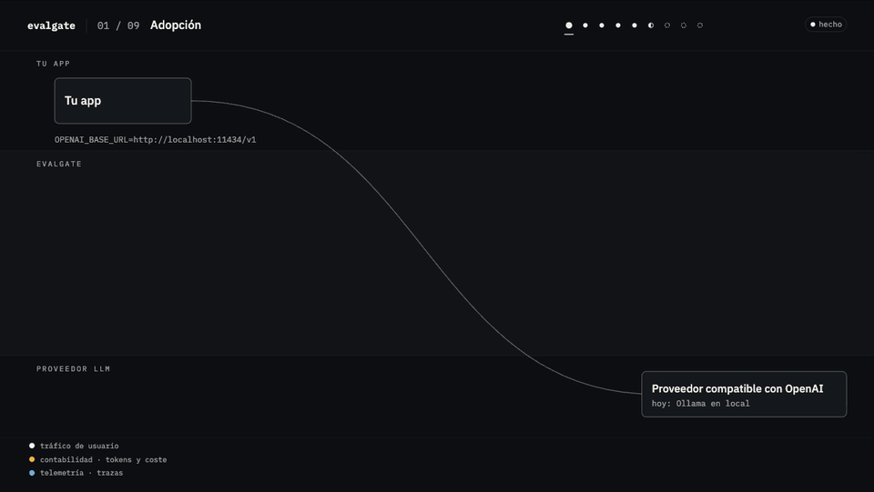

# Evalgate

> **Un evaluador no evaluado es un adorno.**

Evalgate es una puerta de calidad para aplicaciones LLM: un proxy que cuenta tokens y coste, y una
comparación estadística que decide en CI si un cambio empeora el sistema. A diferencia de otras puertas,
publica sus propias tasas de error, medidas.



**Estado.** El proxy, la contabilidad, la telemetría, los precios, el motor de evaluación y la puerta están
cerrados y verificados (fases F0 a F6). La meta-evaluación (F7) está medida y **publicada con tres de sus
cuatro metas por debajo del umbral**; no se ha bajado ninguno. Ver [Resultados](#resultados).

## Qué hace

- **Proxy** compatible con `/v1/chat/completions` de OpenAI, con y sin streaming. Se adopta cambiando una
  variable de entorno. Registra tokens, coste y una traza OpenTelemetry por llamada, también si el cliente
  corta la conexión.
- **Motor de evaluación** que puntúa un sistema caso a caso sobre un conjunto fijo, con los juicios de un
  LLM grabados y reutilizados.
- **Puerta** que compara dos informes con bootstrap pareado (y corrección de Holm cuando hay más de tres
  métricas bloqueantes) y devuelve un código de salida para CI.

No es una plataforma de observabilidad: no tiene interfaz, anotación ni usuarios
([ADR-004](docs/adr/004-evalgate-frente-a-langfuse.md)). La puerta se puede usar sola, con informes
generados desde cualquier herramienta.

## Instalación

Requiere Python 3.12 y [`uv`](https://docs.astral.sh/uv/). No está publicado en PyPI.

```bash
git clone https://github.com/samuvm/evalgate.git
cd evalgate
uv sync --locked
uv run evalgate --help
```

## Uso

### Proxy

```bash
uv run evalgate serve --port 8080 --upstream http://localhost:11434/v1
OPENAI_BASE_URL=http://127.0.0.1:8080/v1 python tu_app.py
```

La aplicación no cambia. Con `--clickhouse <DSN>` las trazas se guardan en ClickHouse
(`uv run evalgate migrate` crea el esquema); si el almacén se cae, las peticiones siguen sirviéndose.

### Puerta en CI

```bash
uv run evalgate eval compare base.json head.json --gate gate.yaml --out resultado.json
```

| Código | Significado |
|---|---|
| 0 | El cambio puede entrar |
| 1 | Bloqueado: alguna métrica bloqueante empeora de forma significativa |
| 2 | Los informes no se pueden comparar |

Entradas:

- **Dos informes** con el formato de [`eval-report.schema.json`](docs/CONTRACTS/eval-report.schema.json).
  Cada métrica apunta con `raw_path` a su valor por caso. Los dos informes deben traer los mismos casos.
- **`gate.yaml`** con las métricas y su papel:
  ```yaml
  metrics:
    - { id: answer_correct, blocking: true }
    - { id: tasa_de_error, blocking: true, higher_is_better: false }
    - { id: longitud, blocking: false }
  ```
- **`--goals`** (opcional): un YAML con el bloque `comparacion` (réplicas, semilla, nivel de confianza). Por
  defecto, [`docs/GOALS.yaml`](docs/GOALS.yaml).

### Ejemplo incluido

```bash
# La puerta bloqueando una regresión, con informes de ejemplo
uv run evalgate eval compare evals/suites/compare-fixture/base.json \
  evals/suites/compare-fixture/head-regresion.json \
  --gate evals/suites/compare-fixture/gate.yaml --out /tmp/resultado.json

# Este repositorio pasando por su propia puerta, sin llamar a ningún modelo
uv run evalgate eval self-gate

# La aplicación RAG de ejemplo detrás del proxy (necesita Ollama en localhost:11434)
make up
python examples/rag-app/generate_corpus.py
OPENAI_BASE_URL=http://127.0.0.1:8080/v1 python examples/rag-app/rag_app.py --limit 3
make down
```

## Métricas

| Métrica | Qué cuenta | Bloquea |
|---|---|---|
| `answer_correct` | La respuesta contiene la referencia y ninguna respuesta excluida | sí |
| `context_recall` | Parte de los documentos relevantes que se recuperaron | sí |
| `abstencion_incorrecta` | El sistema dijo "no consta" cuando la respuesta estaba | sí |
| `faithfulness` | Un juez LLM dice que la respuesta se apoya en el contexto | no (retirada) |
| `juez_ilegible` | El veredicto del juez no se pudo leer | no |

`faithfulness` se calcula y se publica, pero no decide: su juez no alcanza la concordancia exigida con la
etiqueta humana. El motor trae hoy métricas de un sistema RAG; para otros sistemas, la puerta acepta
cualquier informe con el formato del contrato.

## Resultados

Todos los números de esta sección los genera `make report` desde `evals/reports/`. El detalle completo
está en [`docs/NUMEROS.md`](docs/NUMEROS.md).

### La puerta, medida

Medida ejecutando el sistema muchas veces con ruido y comparando cada ejecución contra una línea base fija:

<!-- evalgate:meta:start -->
| Meta | Medido | Umbral | ¿Cumple? | Detalle |
|---|---|---|---|---|
| `G-JUDGE-KAPPA` | 0,47 | >= 0,60 | **no** | IC95 [0,27, 0,65] · 150 etiquetas humanas · acuerdo bruto 0,86 |
| `G-GATE-FP` | 0,102 | <= 0,05 | **no** | Wilson 95 % [0,044, 0,218] · 5 bloqueos en 49 decisiones contra `base-00` |
| `G-GATE-MDE` | 10,50 | <= 8,00 | **no** | puntos porcentuales, en `answer_correct` · 200 casos · 2450 pares de 50 ejecuciones |
| `G-GATE-POWER` | 1,00 | >= 0,90 | sí | mínimo sobre las degradaciones de tamaño ≥ 15,75 pp · mínimo sobre las 4: 0,02 |
<!-- evalgate:meta:end -->

En la práctica: comparando una ejecución contra otra con ese ruido, la puerta bloquea de más y no distingue
caídas pequeñas, pero bloquea siempre las dos degradaciones grandes. Con salidas deterministas o grabadas
ese ruido no existe.

### El resto del sistema

<!-- evalgate:numbers:start -->
Último cierre en verde: F6, 2026-10-08 (`evals/reports/gate-F6.json`).

| Meta | Qué mide | Valor |
|---|---|---|
| `G-ADOPTION` | Adopción por variable de entorno, sin tocar código | lineas_de_diff=0, n_lineas=8 |
| `G-CACHE-HIT` | Coste marginal de re-ejecutar la suite | 0,00 |
| `G-CACHE-INVAL` | La clave de caché de jueces invalida exactamente lo que debe | ratio=1, n=63 |
| `G-DETERMINISM` | Determinismo de eval compare | ratio=1, n=3 |
| `G-DISCONNECT` | Contabilidad ante desconexión del cliente | ratio=1, n=217 |
| `G-FUNC-COV` | Un test unitario por función pública, con extensión de propiedad | 0 |
| `G-LAT-PROXY` | Sobrecarga p95 del proxy, no-streaming | 6,97 |
| `G-LAT-TTFT` | Sobrecarga p95 del time-to-first-token, streaming | 3,80 |
| `G-LINE-COV` | Cobertura de línea en paquetes testable | 99,35 |
| `G-MUTATION` | Mutantes muertos en paquetes con TDD obligatorio | 88,58 |
| `G-OPENAI-CONTRACT` | Compatibilidad con el esquema publicado de OpenAI | ratio=1,00, n=7 |
| `G-OTEL-CONTRACT` | Spans conformes al contrato OTel GenAI pineado | ratio=1, n=25 |
| `G-PRICE-REPRO` | Reproducibilidad de informes de coste históricos | 0,00 |
| `G-TOKENS-EXACT` | Contabilidad exacta de tokens en no-streaming | ratio=1, n=5 |
| `G-TOKENS-STREAM` | Contabilidad de tokens en streaming | delta_con_usage=0 |
| `G-TRACE-0` | Cero spans perdidos con almacén sano | perdidos=0, rps=50, servidas=6000 |
| `G-TRACE-DEGRADE` | Degradación elegante con el almacén caído | 0,08 |
<!-- evalgate:numbers:end -->

## Diseño

- **Una traza nunca tumba ni retrasa una petición.** Cola acotada que, al llenarse, descarta y lo cuenta.
- **La contabilidad se cierra siempre.** Cliente cortado, tokens pagados, tokens contados.
- **Ningún precio en el código.** Tablas fechadas e inmutables; corregir un precio es publicar otra.
- **Ningún umbral en la puerta.** Todo parámetro de decisión llega de `docs/GOALS.yaml`.
- **Comparación pareada o error.** Informes con casos distintos no se comparan.
- **Ninguna métrica llama a un modelo**, y el juez nunca es el modelo que genera.

Cada regla tiene un comprobador automático ([`docs/RULES.md`](docs/RULES.md)); las decisiones están en
[`docs/adr/`](docs/adr/).

## Limitaciones

- Probado solo contra Ollama en local. Ningún proveedor de pago ni Bedrock.
- Sin conciliación contra una factura real: el coste es el declarado por una tabla de precios pública.
- El corpus de evaluación es sintético por construcción: mide si la puerta detecta degradaciones, no la
  calidad de un dominio real.
- El flujo de CI (`.github/workflows/gate.yml`) está escrito y sin activar.

## Desarrollo

```bash
make lint typecheck   # ruff y mypy --strict
make test-fast        # unitarios, propiedad y contrato
make test-int         # integración contra ClickHouse (necesita Docker)
make report           # regenera las tablas de este README
```

| Ruta | Contenido |
|---|---|
| `src/evalgate/proxy/` | Proxy and stream accounting |
| `src/evalgate/pricing/`, `telemetry/` | Dated prices; OTel traces and ClickHouse |
| `src/evalgate/evals/`, `gate/`, `stats/` | Metrics, cached judges, decision and statistics |
| `examples/rag-app/` | Example application; imports nothing from the package |
| `evals/` | Cases, suites and the reports every number comes from |
| `docs/` | Roadmap, goals, rules, ADRs and gate evidence |

`make gate-fast` and `make done` are the gate each phase closes with. They read local state (`.gate/`) and a
held-out test suite that is kept private so it cannot be tuned against, so they are not reproducible outside
the development machine; the tests and the rule checkers are.

## Licencia

[Apache-2.0](LICENSE).
